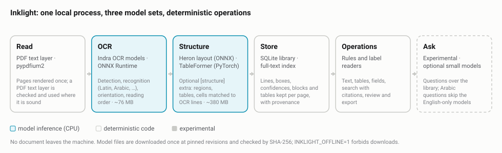
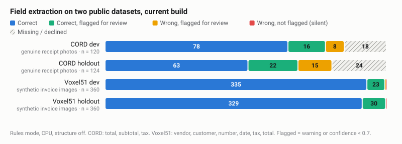
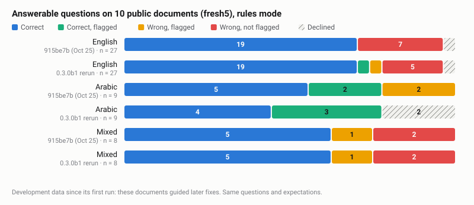
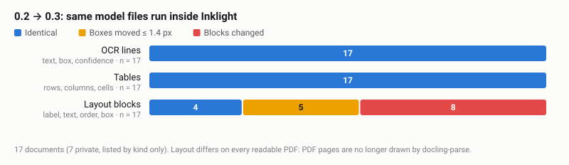
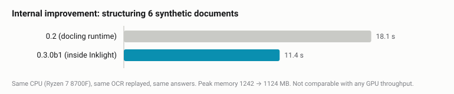
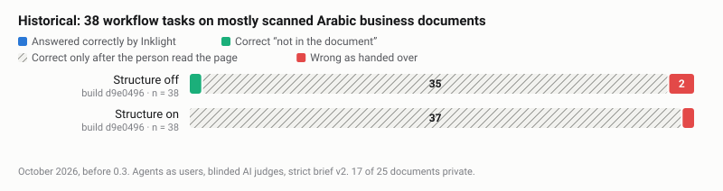
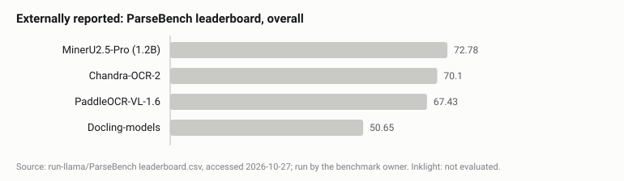
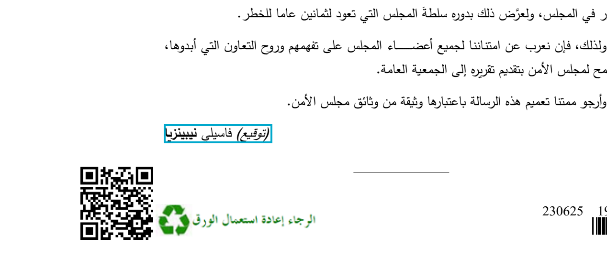
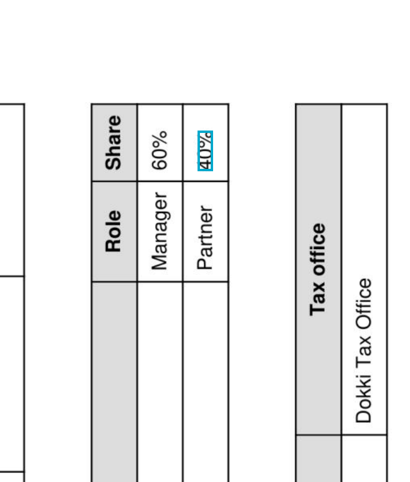
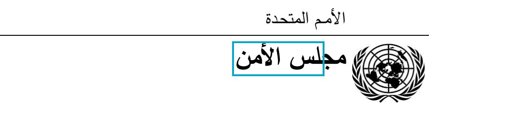

# Inklight 0.3: a technical report

<!-- Generated by evaluation/report/build.py from REPORT.template.md and the stored results. Edit the template. -->

**Version assessed:** Inklight 0.3.0b1 (developer beta, GitHub only), October 2026; the runs name their exact build.
**Machine for the current runs:** Windows 11, AMD Ryzen 7 8700F (8 cores, 16 threads), 31.6 GB RAM, CPU only;
Python 3.13.9, ONNX Runtime 1.31.0, PyTorch 2.14.1 (CPU). Historical runs record their own environments.

## Abstract

Inklight is a local document-processing system: it reads PDFs and images on the user's machine, keeps every line it
reads with its page and box, and offers a few operations on top: extract text, extract tables, extract fields,
search, review and export, plus an experimental question mode. It is an **integrated system built from existing
models**, not a newly trained model. It runs the Indra OCR models (Datalab), the Heron layout model and TableFormer
(Docling project) inside its own code, with ONNX Runtime and PyTorch on the CPU. Inklight trained none of these.

What we measured:

- **Field extraction on two public datasets** (development data: the dev splits were used for development and the
  holdouts were run repeatedly). On synthetic invoice images (Voxel51 holdout, 360 values)
  91.4% of values need no review and 99.7% of unflagged values are correct. On
  genuine receipt photos (CORD holdout, 124 values) only 50.8% need no review. On the
  one independent receipt split (CORD fresh, historical build H), 4 of 127 values
  were wrong without a flag.
- **Moving the models inside Inklight changed no OCR line and no table** on a 17-document check against the previous
  release. Layout regions on PDF pages did change, on every readable PDF.
- **Document structure helps on tables it can see.** On 6 synthetic documents (3 registration cards, each as a digital
  PDF and a scan), correct answers rose from 2 to 18 of 18 in English
  and from 4 to 10 of 18 in Arabic, and silent errors on answerable
  questions fell from 12 to 0. On realistic scanned business documents (section 3.5) it
  did not raise task completion.
- **It does not complete realistic office tasks on its own.** In a historical agent-run evaluation of 38 tasks on
  mostly scanned Arabic business documents, Inklight completed 1 task (a correct "not in the
  document"); 35 correct results needed a person to read the page.

The comparison with other systems is limited by evidence: **Inklight has run none of the public parsing benchmarks**
(ParseBench, olmOCR-bench, OmniDocBench), so no score is given or estimated for it. Other systems appear with the
results their authors or benchmark owners report, under their conditions, and next to a qualitative comparison.

A successful import is not a successful extraction, and correct OCR is not a correct answer. The sections below
keep these stages apart.

## 1. What Inklight is



*Figure 1. One process on the user's machine. Highlighted stages run model inference on the CPU; the rest is
deterministic code. The structure stage is an optional install; Ask is experimental.*

| Stage | What it does | Runs | Supported? |
|---|---|---|---|
| OCR transcription | Lines of text with boxes and confidences; Latin, Arabic and other scripts; page orientation; reading order. A sound PDF text layer is used instead. | Indra OCR models, ONNX Runtime (code adapted from indra-ocr 1.1.2) | Supported |
| Layout and reading order | Regions (text, title, table, picture…) and their order | Heron layout model (ONNX), Docling post-processing and rule-based order (adapted from Docling 2.142.1) | Supported with `[structure]` |
| Table reconstruction | Rows, columns, header rows; cells filled with the OCR's lines | TableFormer (PyTorch), cell matching | Supported with `[structure]` |
| Field extraction | Named fields ("invoice number", "<bdi dir="rtl">رقم القيد</bdi>") from labels and rows, with page and box | Rules and label readers | Supported |
| Search and citations | Full-text search (Arabic normalised); every hit is a line or block with its page and box | SQLite FTS5 | Supported |
| Question answering | Plans a request, selects documents, answers with cited passages or declines | Rules; optional small English models | **Experimental** |
| Review and export | A person accepts, corrects or marks each value; approved values export with prediction, decision and source | Review store | Supported |

**Model files.** Every model is downloaded once from its Hugging Face repository at a pinned commit and checked by
SHA-256: OCR about 76 MB, layout 171 MB, tables 213 MB. With `INKLIGHT_OFFLINE=1` nothing is downloaded. By design
no document or text is sent anywhere (this is how the code is built, not a measurement). The Indra OCR weights are
under Datalab's modified OpenRAIL-M licence: free for research, personal use and organisations under $20M funding or
revenue, and not for use competing with Datalab's API (model card, class B).

**What is new in 0.3.** Until 0.2 the same models ran through the `indra-ocr` and `docling` packages. In 0.3 their
inference code runs inside Inklight (`inklight/backends`), cut down to the path Inklight uses; `docling-core` remains
as the data model of the stored structure. This is an engineering change, not a modelling one: the weights are the
same files.

## 2. Evaluation protocol

Each result below is labelled with one of three evidence classes:

- **A. Measured.** Our own runs, with stored outputs in [`evaluation/results/`](results/). We say which build,
  which documents, and whether those documents were used to develop Inklight.
- **B. Externally reported.** Numbers published by a system's authors or a benchmark owner. Quoted, with the source,
  benchmark, version and conditions. We did not run these systems.
- **C. Qualitative assessment.** Our judgement of likely trade-offs from documentation and architecture. Hypotheses,
  not measurements.

**Outcomes.** A value or answer is *correct*, *correct but flagged* (it asks for review: a warning, or confidence
under 0.7 for fields), *wrong but flagged*, *wrong and not flagged* (a **silent error**), or *missing / declined*.
The useful outcome is a correct, unflagged value; the harmful one is the silent error. "Coverage without review" is
the share of values that are correct and unflagged.

**Independence.** A split is independent only for its first run. Later runs on the same documents follow fixes
those documents prompted, so they are development data, and are labelled so.

**Hardware and caches.** CPU only, the machine above. Model files were already on disk (warm model cache). Sections
3.1 and 3.2 started from an empty library, so every document was read by OCR and the times include it; section 3.3
and Figure 5 replay stored OCR.

## 3. Measured results (class A)

### 3.1 Field extraction on public datasets



*Figure 2. Every annotated value of four development splits, read by 0.3.0b1 from the original image files.
Synthetic invoices are almost fully covered; genuine receipt photos are not. On these splits no unflagged receipt
value is wrong; on the independent fresh split (historical) 4 of 127 were.*

| Split | Documents | Values | Correct (incl. flagged) | No review needed | Unflagged values correct | Silent errors |
|---|---|---|---|---|---|---|
| Voxel51 dev (synthetic invoices) | 60 | 360 | 99.4% | 93.1% | 99.7% | 1 |
| Voxel51 holdout | 60 | 360 | 99.7% | 91.4% | 99.7% | 1 |
| CORD dev (genuine receipts) | 60 | 120 | 78.3% | 65.0% | 100.0% | 0 |
| CORD holdout | 60 | 124 | 68.5% | 50.8% | 100.0% | 0 |
| CORD fresh: independent first run, **historical** build H (`3788bf9`) | 60 | 127 | 61.4% | 47.2% | 93.8% | 4 |

- **Build:** the working tree at `a6f3ad4` with the type-scope fix before it was committed as `26445bf` (no wheel hash
  recorded; the fix changes which documents a request covers, not field values). Rules mode, structure off. Raw
  results: `results/external/v030-*.json`.
- **Compared with earlier builds.** The counts equal those of builds F and G (BENCHMARKS.md) except on CORD holdout,
  where F had 2 silent errors and G had 1; both are now flagged by the amount check. Those 2 receipts (015, 032) are
  regression examples for that check, so the holdout is not evidence that it works. CORD fresh was not rerun.
- **Not independent.** Dev was used for development; the holdouts were run several times during 0.1 development.
  The one Voxel51 silent error per split is the dataset's own annotation of a net amount as the total (dev invoice
  `batch1-0487`, holdout `batch1-0217`), kept as an error.
- **Speed:** 60 receipt photos were read in 7.73 s and 60 invoice images in
  15.07 s, including OCR.

**Requests over the whole set** (find, count, sum, export, refuse), same runs: Voxel51 holdout:
12 correct, 4 silent wrong, 4 useful abstention; CORD holdout: 7 flagged, 4 useful abstention. All 4 Voxel51 silent results trace to the same
annotated invoice (each is off by exactly its 10% VAT). The CORD requests are flagged because some receipt totals
cannot be read.

> **A regression found while writing this report, and fixed.** Before the fix, "Find receipts above Rp 39,000" on
> CORD dev listed 1 receipt where 28 were expected and reported success, and
> 7 of 11 CORD holdout requests were silent errors (`results/external/v030-prefix-*.json`). Only 3
> of 60 photos are classified as receipts (none were in build I), and the word "receipts" dropped the 57 typed
> "unknown". The cause is a classifier change made before 0.3, not the model move (OCR output is identical). Commit
> `26445bf` keeps unknown documents that show a sign of the type, says how many were included or left out, and
> reports the result as partial. CORD dev requests now match build I exactly.

### 3.2 Answerable questions on public documents (development data)



*Figure 3. The 44 answerable questions of the fresh5 split (10 public documents: UN letters in English and Arabic,
Wikipedia pages, FUNSD forms, receipt photos), rules mode. Before: build `915be7b`, its first and independent run
(25 October). After: 0.3.0b1 at `26445bf`, after every later fix, some prompted by these documents. Correct:
31 → 32 of 44.*

- English: 20 of 27 correct (was 19); silent errors 5
  (was 7).
- Arabic: 7 of 9 (was 7); no silent error; two Arabic report questions
  that were wrong but flagged are now declined.
- Mixed language: 5 of 8 (was 5); 2
  silent errors.
- The independent first-access results of all seven splits are in [EVALUATION.md](EVALUATION.md).

### 3.3 Document structure on synthetic registration cards

6 synthetic documents: an Arabic, an English and a mixed registration card, each as a digital PDF and as a scan, with
tables; made by `bench/structure/make_synthetic.py`, written by the same author as the code. OCR replayed from
storage; 0.3.0b1.

| Answerable questions | Structure off: correct | Structure on: correct | Silent errors off → on |
|---|---|---|---|
| Arabic | 4 of 18 | 10 of 18 | 4 → 0 |
| English | 2 of 18 | 18 of 18 | 5 → 0 |
| Mixed | 6 of 10 | 10 of 10 | 3 → 0 |

Citations of correct answers hold the value: 12/12 (off), 38/38 (on). 2
unanswerable English questions ("What is the company's capital?", which is not printed) are answered silently with
structure on or off. Where structure is still wrong, the OCR misread an Arabic-Indic number (for example "EVY19" for
<bdi dir="rtl">٤٧٣١٩</bdi>); those answers are flagged by the OCR's low line confidence
([STRUCTURE.md](../docs/STRUCTURE.md)).

### 3.4 Moving the models inside Inklight (0.2 → 0.3)



*Figure 4. 17 documents read by 0.2 (through `indra-ocr` and `docling`) and by 0.3 (inside Inklight), same model
files and settings. OCR and tables are identical on every document; layout regions differ on all
13 readable PDFs.*

- **Identical:** every OCR line on every page; the tables of all 17 documents; the 3 image files end
  to end; the broken PDF fails the same way. The baseline was deterministic (two runs, identical).
- **Different:** on 5 PDFs only box positions moved (at most 1.4 px); on
  8 the layout model also labelled, merged or ordered some blocks differently (for example a heading
  merged into the paragraph above). Docling drew PDF pages with its own renderer (docling-parse), which 0.3 does not
  reproduce bit for bit; it prepares page images the same way otherwise. No OCR text was lost or added.
- **Installed wheel:** a clean install without the old packages gave output identical to the development tree, 17
  of 17. Documents: 7 private business documents (listed by kind only), public UN letters and a receipt
  photo, synthetic cards and tables. Summary: `results/migration-0.3/summary.json`.



*Figure 5. An internal improvement, not a comparison with any other system: structuring the 6 synthetic documents
took 11.4 s instead of 18.1 s on the same CPU, with identical answers. A single run that
includes loading the models; not a per-page throughput.*

### 3.5 Historical: realistic tasks on scanned Arabic business documents



*Figure 6. Historical (October 2026, build `d9e0496`, before 0.3). 38 tasks on 25 documents (17 private documents,
mostly scanned Arabic registers, tax cards and certificates; public receipts and UN letters), each attempted by an AI
agent acting as the user with up to four actions, and judged by separate blinded AI judges. Inklight completed
1 task with structure off and 0 with structure on; every other correct deliverable needed
the person to read the page.*

This is the most realistic measurement we have, and it is negative. Values were lost at OCR and after it: in the
original run (build `3f1ec75`), OCR was the earliest failing stage in 16 of 38 tasks, and 51 of 199 reference values
(26%) never reached the stored text; document selection, request parsing, retrieval and answer choice account for
most of the rest. The full report, with failures ranked and the fixes made before the rerun, is
[AGENT_EVALUATION.md](AGENT_EVALUATION.md). It has not been rerun on 0.3, and we make no claim about how 0.3 would do
on these tasks.

## 4. Comparison with existing approaches

### 4.1 Systems compared (classes B and C)

We chose five systems: OCRia-1 (LlamaIndex's parsing model, whose October 2026 report prompted this one), Docling
(whose layout and table models Inklight runs), Datalab's Chandra-OCR-2 (Indra OCR's authors), MinerU and PaddleOCR.
**None was run**; everything below is from their papers, model cards, repositories, and the ParseBench leaderboard,
accessed 2026-10-27.

| | Inklight 0.3.0b1 | OCRia-1 | Docling | Chandra-OCR-2 | MinerU 2.5 | PaddleOCR-VL / PP-StructureV3 |
|---|---|---|---|---|---|---|
| Runs locally | Yes (A); OCR weights under a modified OpenRAIL-M licence (B) | No: weights not released; hosted LlamaParse (B) | Yes (B) | Yes, self-hosted; weights under a modified OpenRAIL-M licence (B) | Yes (B) | Yes (B) |
| Hardware | CPU (A) | Reported only on NVIDIA B200 (B) | CPU supported; layout model sub-second on CPU (B) | GPU for reported runs (H100, vLLM) (B) | CPU basic tier; GPU tiers, A100 recommended for the VLM (B) | CPU or CUDA (B) |
| Model size | About 460 MB of model files (A) | 4B (B) | Heron 42.9M + TableFormer (B) | 5B per model metadata (B) | 1.2B (B) | 0.9B VLM; PP-OCR 1.5–34.5M (B) |
| Output | Lines, blocks, tables, fields, all with page and box (A) | Markdown, HTML tables, LaTeX; **no boxes** (B) | Markdown, HTML, JSON with provenance boxes (B) | Markdown, HTML, JSON with layout (B) | Markdown, JSON, etc. (B) | Markdown, JSON; coordinates in PP-StructureV3 (B) |
| Review and correction | Built in: per-value decisions, approval, audit trail, export (A) | Not stated | Not stated | App and playground; review not stated | Web UI; review not stated | Web demo; review not stated |
| Arabic evidence | Measured here on UN letters, synthetic cards and scanned business documents (A) | Arabic, Greek and Korean tables weakest, 0.70–0.77 on PulseBench-Tab (B) | Not stated; depends on OCR engine chosen (B) | 68.4% Arabic on Datalab's 43-language benchmark (B) | Not stated by MinerU; Arabic edit distance 0.978 for MinerU2.5 in the PaddleOCR-VL paper (B) | Arabic edit distance 0.122 for PaddleOCR-VL (0.9B) on its authors' in-house set; not stated for VL-1.6 (B) |
| Install | `pip install`, CPU wheels, models fetched on first use (A) | Cloud API | `pip install docling` (B) | `pip install chandra-ocr`; vLLM via Docker (B) | `pip install mineru` with extras (B) | `paddleocr` + `paddlepaddle` (B) |
| Public parsing benchmark | **Not evaluated** | ParseBench "87.4 overall", a **different aggregate**: 4 dimensions, vendor-run (B) | ParseBench 50.65 (B) | ParseBench 70.1; 74.85 on the same 4 dimensions as OCRia-1 (B) | ParseBench 72.78 (2.5-Pro) (B) | ParseBench 67.43 (VL-1.6) (B) |



*Figure 7. Externally reported, not measured by us. The ParseBench leaderboard's overall score: the mean of five
dimensions, run by LlamaIndex, which owns the benchmark and also develops OCRia-1. The dataset version, system
versions, settings and hardware are not stated. OCRia-1 is not on the leaderboard; its 87.4 averages four dimensions
(visual grounding excluded, since it outputs no boxes) and is not on this axis. Inklight has not been run on
ParseBench and has no bar.*

**Inklight's models in their authors' measurements (class B).** The layout model Inklight runs (Heron, 42.9M) reports
0.699 mAP on the DocLayNet test set and 0.776 on canonical DocLayNet, at 0.643 s per image with PyTorch (batch 32) on
a 4-thread AMD EPYC 7763; Inklight runs its ONNX export (arXiv:2509.11720). TableFormer reports structure TEDS of
96.75 on PubTabNet and 96.8 on FinTabNet in its 2022 paper (arXiv:2203.01017); the shipped checkpoint is not stated to
be that exact model. Indra OCR's authors report 66.7 on their own OmniParseBench (the benchmark's leaderboard lists
69.5 for "Indra OCR"; the sources do not explain the difference), 69.2 on its 13 Arabic tests (they note scores at
this size can move 2–8 points), 6.2 pages per second on 4 cores of an AMD EPYC 9004, and that it is not the right
tool for complex tables, handwriting, or old or faded scans. These numbers were measured with the authors' own code,
not Inklight's adaptation, and Inklight's measurements neither confirm nor refute them.

### 4.2 What the comparison suggests (class C, hypotheses)

- **Accuracy on hard pages.** The vision-language parsers (OCRia-1, Chandra, MinerU 2.5, PaddleOCR-VL) read page
  images with billion-parameter models; Inklight's OCR has about 7M parameters across its default models. On degraded
  scans, handwriting, charts and complex tables we expect them to be more accurate. The agent-run evaluation shows
  OCR losses on photocopied cards and rotated certificates.
- **Cost of running.** Inklight needs no GPU and read 60 receipt photos in 7.73 s on a desktop CPU
  (section 3.1). The VLM parsers report throughput on data-centre GPUs. These are different operating points, not a
  speed ranking.
- **Provenance.** Inklight keeps a box for every line, table cell and field, and draws the source on the page, also on
  turned pages. OCRia-1 outputs no boxes; Docling, MinerU and PaddleOCR keep coordinates. A reviewer needs the box.
- **Review.** None of the others documents a per-value review and approval workflow; they are parsers meant to feed
  other software. This is a difference in scope, not quality.
- **Where Inklight is weakest:** both reading hard scans and turning what was read into the right answer (section
  3.5).

## 5. Selected examples

Selected examples, chosen because they work; they are not a sample of typical performance. Each shows the page,
Inklight's actual output from `evaluation/report/examples.py` (0.3.0b1, rules mode, structure on), and what was
checked. Synthetic documents are marked. The UN letter S/2025/380 belongs to the fresh5 split, so it is development
data.

**5.1 Arabic: who signed the letter.** Public UN document S/2025/380 (Arabic).



- Request: «<bdi dir="auto">من وقع الرسالة؟</bdi>» ("who signed the letter?")
- Output: «<bdi dir="auto">فاسيلي نيبينزيا</bdi>», page 1, box `342.2, 1890.5, 568.8, 1929.8`, evidence «<bdi dir="auto">(توقيع) فاسيلي نيبينزيا</bdi>».
- Checked: the outlined line on the page image is the signature line, and the name matches it.

**5.2 Tables that keep values under their headings.** Synthetic `suppliers.pdf`.

| Table | Company name | Company type |
|---|---|---|
| 1 | Alpha Ltd | Limited company |
| 2 | Beta Ltd | Limited company |

- Output of `inklight tables`: two tables, each with its header row marked.
- Checked: every cell equals the PDF's text layer, under the right heading.

**5.3 A turned page.** Synthetic `registration-card-turned.pdf`, scanned and turned 90°.



- Request: "What is Laila Mansour's share?" → «<bdi dir="auto">40%</bdi>» from a table cell.
- Checked: the box, stored in the upright frame, is drawn on the page as the file shows it and lands on the right
  cell.

**5.4 The same fields compared across documents.** Synthetic invoices.

| File | Invoice number | Total | Source line |
|---|---|---|---|
| invoice_acme.pdf | INV-2041 | 5,616.00 | “Total: $5,616.00”, page 1 |
| invoice_globex.pdf | GX-7781 | 2,640.00 | “Total: $2,640.00”, page 1 |

Checked against each PDF's text layer.

**5.5 An ambiguous request handled honestly.** Synthetic `suppliers.pdf`, two suppliers.

- Request: "What is the company name?"
- Output: “Company name” has a different value in each of 2 tables: Alpha Ltd: table on suppliers.pdf, page 1; Beta Ltd: table on suppliers.pdf, page 1. The warning asks which one is meant.
- Checked: neither name is chosen silently; both are listed with where they are.

**5.6 A silent error caught by review, exported with provenance.** Synthetic turned card; the review is scripted in
`examples.py` (an "example reviewer"), not a person.

- Inklight extracted the company name «<bdi dir="auto">Golden Palm Trading</bdi>» with confidence 0.8 and **no flag**:
  the wrapped "Co." was lost, a silent error. The reviewer corrected it to «<bdi dir="auto">Golden Palm Trading Co.</bdi>»
  and accepted the tax office. The approved export keeps both the prediction and the decision, with page and box:

```csv
document,field,predicted,source_page,source_bbox,final,action,approved_by
registration-card-turned.pdf,company_name,Golden Palm Trading,1,"[191.8, 520.1, 512.4, 552.4]",Golden Palm Trading Co.,corrected,example reviewer
registration-card-turned.pdf,tax_office,Dokki Tax Office,1,"[942.8, 1168.6, 1192.4, 1192.9]",Dokki Tax Office,accepted,example reviewer
```

## 6. Failures and limitations

**6.1 Most realistic office tasks need a person** (section 3.5): 1 of 38 completed. The fixes made before that rerun
made failures safer (labels are no longer returned as values; several candidates are listed), not more complete.

**6.2 The OCR drops a letter in a large Arabic heading.** Public UN letter S/2025/380 (development data).



The letterhead «<bdi dir="auto">مجلس الأمن</bdi>» is stored as «<bdi dir="auto">جلس الأمن</bdi>» (line
confidence 0.87): the box starts after the first letter. Search still finds the document, through the body
text.

**6.3 Field extraction and questions disagree on the turned card.** `agent.extract(card, fields=["company name",
"registration number"])` returns «<bdi dir="auto">Golden Palm Trading</bdi>» (the wrapped "Co." is lost) and no
registration number, while asking "What is the registration number?" answers 47319 from the table.
Extraction reads labels, not table cells. In the partners table the OCR read "Manager 60%" as one line, so both
values land in one cell.

**6.4 A date question returns the whole line.** «<bdi dir="auto">ما تاريخ الرسالة؟</bdi>» returns the full title line
that contains the date, flagged "the evidence only weakly supports this answer".

**6.5 Receipts.** On genuine receipt photos about half the values need review or are missing (section 3.1), and on
the independent split 4 of 127 values were silently wrong.

**6.6 Not measured:** handwriting; genuine Arabic invoices and forms; documents over 36 pages; any public parsing
benchmark; use by people (no human study has been run; no time savings are claimed).

## 7. Reproducibility

```bash
pip install -e ".[structure,dev]"
python -I bench/external.py --data DATA --dataset cord --split holdout --brain rules --home EMPTY --label X --out OUT.json
python -I bench/usecases/evaluate.py --split fresh5 --docs DOCS --models MODELS --brain rules --out OUT
python bench/structure/compare.py --docs ./synthetic --models MODELS --out structure-compare.json
python -I evaluation/report/examples.py --un-letter S_2025_380-ar.pdf --out evaluation/report/examples
python evaluation/report/build.py
```

Datasets are not redistributed; `bench/prepare_external.py` and `bench/usecases/README.md` say where to get them.
Every result file records the interpreter, commit, model calls and timings; local folders are shortened to `~` and
`<scratch>`. The full evaluation archive is indexed in [evaluation/README.md](README.md).

## References

1. LlamaIndex. OCRia-1 (blog), https://www.llamaindex.ai/blog/parse-ocria-1, and OCRia-1 Technical Report, October
   2026, https://www.llamaindex.ai/ocria/ocria-1-technical-report.pdf.
2. run-llama. ParseBench leaderboard, https://github.com/run-llama/ParseBench (leaderboard.csv), and Zhang et al.,
   ParseBench, arXiv:2604.08538.
3. Livathinos et al. Advanced Layout Analysis Models for Docling, arXiv:2509.11720.
4. Nassar et al. TableFormer: Table Structure Understanding with Transformers, arXiv:2203.01017.
5. Deep Search Team. Docling Technical Report, arXiv:2408.09869; https://github.com/docling-project/docling.
6. Datalab. Indra OCR, https://huggingface.co/datalab-to/indra-ocr, https://github.com/datalab-to/indra; OmniParseBench,
   https://github.com/datalab-to/omni_parse_bench.
7. Datalab. Chandra, https://github.com/datalab-to/chandra; chandra-ocr-2 model card.
8. Niu et al. MinerU2.5, arXiv:2509.22186; https://github.com/opendatalab/MinerU.
9. Cui et al. PaddleOCR-VL, arXiv:2510.14528; https://github.com/PaddlePaddle/PaddleOCR.
10. Datasets: CORD v2 (naver-clova-ix, CC-BY-4.0); Voxel51 high-quality invoice images (ODbL); UN documents from
    https://documents.un.org.

All web sources accessed 2026-10-27.
